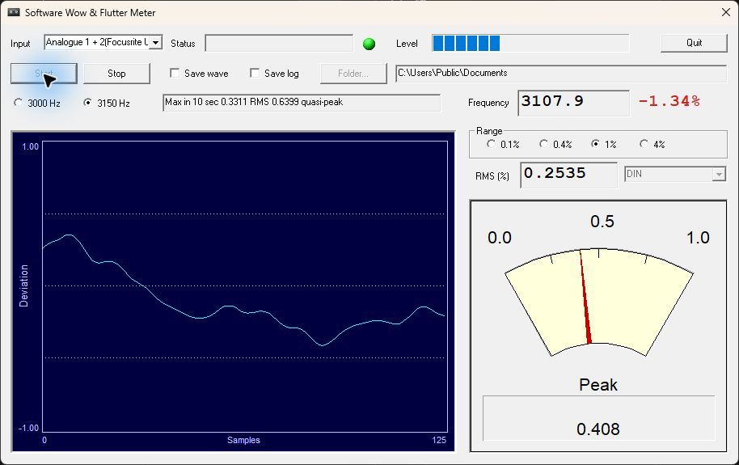

# Wow & Flutter Analyzer (WFGUI)

Windows software for measuring tape transport speed and wow & flutter from a
3000 Hz or 3150 Hz test tone.

This is **BaristaYU's modified fork** of
[sibiryakov/wow-and-flutter-analyzer](https://github.com/sibiryakov/wow-and-flutter-analyzer),
originally written by **Alex Freed**. It retains the original meter and adds
Scarlett Solo Input 2 support, a speed error display, measurement logging, and an
output folder picker. This README describes the source in this fork.



Live tape playback with a 3150 Hz reference and DIN weighting. The displayed
values are an example from one measurement, not a performance target.

## Features

- Captures **44.1 kHz, 16-bit stereo PCM** through the Windows `waveIn` API and
  measures the **right channel only**. On a Scarlett Solo 3rd Gen stereo input
  pair, this corresponds to **Input 2**. The left channel is ignored.
- Selects the Windows input device using its device ID, including when the list
  is sorted alphabetically.
- Supports 3000 Hz and 3150 Hz reference tones, with Unweighted, DIN, Wow, and
  Flutter filter choices.
- Displays frequency, signed speed error, RMS, a quasi-peak needle, a deviation
  graph, and the legacy 10-second maximum summary.
- **Save log** writes comma-separated measurements to `WFGUI_log.txt` at
  **0.1-second intervals while the signal is valid**. Its one-second values use
  a rolling window independent of the display update.
- **Save wave** writes the unweighted demodulated half-period error to
  `WFGUI_wave.dat`: headerless, little-endian **signed 32-bit** data, rather than
  a WAV recording. Out-of-range values saturate instead of wrapping sign.
  `WFGUI_wave.meta.json` identifies the format and reference frequency.
- **Folder...** selects the output directory and remembers it between launches.

## Requirements and connection

- Windows with an input device that accepts 44.1 kHz / 16-bit / stereo capture.
- A tape with a known **3000 Hz or 3150 Hz** test tone and a cable suitable for
  the deck output and interface input.
- For Scarlett Solo 3rd Gen: connect the deck output to **Input 2**, use its
  line-input setting (INST off), and select the Scarlett stereo recording device
  in WFGUI. Input 1 alone will not feed this build's measurement channel.
  See the [Focusrite hardware guide](https://userguides.focusrite.com/hc/en-gb/articles/23031457294610-Scarlett-Solo-3rd-Gen-hardware-features)
  for the Input 2 line/instrument switch.

There is no ASIO backend, mono fallback, channel selector, or channel mixing.
The right-channel mapping depends on how the driver exposes the stereo pair.
Confirm it with only Input 2 connected. Use the corresponding right input on
other interfaces.

## Quick start

1. Connect and enable the interface before launching `wfgui.exe`.
2. Select the correct **Input** device and the **3000 Hz** or **3150 Hz** reference
   matching the test tape.
3. Choose a filter. `DIN` is the initial selection; choose the setting appropriate
   for the reading you intend to compare.
4. Click **Folder...** and choose a writable directory if saving measurements.
   Initially, the application uses the directory containing the executable.
5. Check **Save log**, **Save wave**, or both **before pressing Start**.
6. Press **Start** and play the tape. Adjust the input gain for a clear signal
   without overloading the interface. The green indicator marks accepted signal
   blocks. Frequency must be within approximately 5% of the selected reference.
7. Press **Stop** to finish and close the output files before opening or copying
   them.

**Each Start replaces the selected output files in that folder.** Copy or rename
a capture before starting the next one. There are no automatic numbered copies.

## Reading the display

| Display or control | Meaning |
| --- | --- |
| Frequency | Carrier estimate, refreshed after ten accepted 0.1-second blocks (about once per second with continuous signal). |
| Signed percentage beside Frequency | Speed error: `(frequency / reference - 1) * 100`. Positive is fast; negative is slow. |
| RMS (%) | RMS deviation after the selected filter, refreshed with the frequency display. |
| Needle | Quasi-peak estimate after the selected filter. |
| Max in 10 sec | Legacy RMS / quasi-peak maximum summary. Rejected blocks can extend its history beyond ten elapsed seconds. |
| Range: 0.1 / 0.4 / 1 / 4% | Display range for the graph and needle. |
| Filter | Unweighted, DIN, Wow, or Flutter. This affects the meter and logged deviation values, but not the raw capture. |

For example, 3134.25 Hz with a 3150 Hz reference is **-0.50%** speed error.
The CSV's frequency and RMS windows move every 0.1 seconds, so its rows need not
match the less frequently refreshed display exactly.

RMS and quasi-peak are different readings. A filter named `DIN` does not by
itself establish compliance with a measurement standard. Compare like settings,
detectors, and test tapes; this fork does not claim certified DIN, IEC, NAB, or
JIS performance.

## Saved measurements

| File | Contents |
| --- | --- |
| `WFGUI_log.txt` | Comment lines beginning with `#`, followed by a CSV header and six numeric columns. Invalid/startup blocks are omitted, and rolling values are initially blank. |
| `WFGUI_wave.dat` | Raw, little-endian, signed 32-bit mono half-period error samples, at the original scale of 0.1 ns per count. No WAV header and no original audio. Import at 6000 Hz for a 3000 Hz reference, or 6300 Hz for 3150 Hz, as nominal rates. |
| `WFGUI_wave.meta.json` | Companion format information: version 2, signed-int32-le, four bytes per sample, reference frequency, units, and saturation policy. Keep it with the `.dat` file. |

**Older captures used signed 16-bit data with the same `.dat` filename.** They
must still be imported as 16-bit. The new version-2 metadata identifies 32-bit
captures; file size alone cannot distinguish the two formats. See the format
reference before opening an archived capture.

See [Measurement output formats](docs/MEASUREMENT_FORMAT.md) for exact columns,
units, timing, raw-data import settings, and limitations. Filenames and formats
from upstream builds (`log.txt`, `WF_out.wav`, or `WF_out.dat`) do not describe
the output of this fork.

## Build on Windows

Install **Visual Studio 2022** or its Build Tools with:

- Desktop development with C++ and the **MSVC v143 x86/x64** tools.
- **C++ MFC for latest v143 build tools (x86 & x64)**, including ATL support.
- An installed Windows 10 or Windows 11 SDK.

Open `wfgui.sln`, choose **Release | Win32**, and build. Alternatively, from a
**Developer PowerShell / Developer Command Prompt for VS 2022** in this folder:

```powershell
msbuild wfgui.vcxproj /t:Rebuild /p:Configuration=Release /p:Platform=Win32 /m
```

The executable is `Release/wfgui.exe`. Debug builds use `Debug/wfgui.exe`.
The project defaults to **v143** and SDK **10.0 (latest installed version)**,
so no specific old SDK needs to be installed. It targets Win32 and links MFC and
the C runtime statically. Keep the application in a writable location or select
a writable measurement folder.

The Windows workflow builds Release and Debug on pull requests and pushes to
`master`. Release executables are available as workflow artifacts; the existing
`v*` tag workflow also publishes a GitHub Release. Historical ZIP binaries are
available through Git history rather than kept in the current source tree.

From **Developer PowerShell for VS 2022**, run the raw-format regression tests:

```powershell
.\tests\run-tests.ps1
```

These check values beyond the old 16-bit limits, 32-bit saturation and non-finite
inputs, exact little-endian file bytes, and metadata for both reference tones.
The workflow runs the same tests after building the application.

## Repository layout

- `wfgui.sln`, `wfgui.vcxproj`, `wfgui.vcxproj.filters`: Visual Studio project.
- Root `*.cpp`, `*.h`, `filters.c`: application, controls, and signal processing.
- `wfgui.rc`, `resource.h`, `res/`: dialogs, icons, and bitmap resources.
- `docs/MEASUREMENT_FORMAT.md`: current capture and CSV format reference.
- `tests/`: raw capture conversion, byte format, and metadata regression tests.
- `.github/workflows/build-windows.yml`: Windows build and artifact workflow.

The source files stay in their original locations to preserve the project
structure and make comparisons with upstream easier. Both `MemDC.h` and
`MemoryDC.h` are used by different controls and must be retained. `res/tape.bmp`
is still referenced by the resource script and is retained as well.

## Troubleshooting and current limitations

| Symptom | What to check |
| --- | --- |
| NO Input Devices Found | Connect and enable a Windows recording device before launching. |
| Signal too low / no useful reading | Feed the right input (Scarlett Input 2), check gain, Windows input/privacy settings, and the selected reference tone. |
| Format not supported / capture cannot start | The selected Windows device must support 44.1 kHz, 16-bit stereo. This build cannot fall back to mono or ASIO. |
| Cannot write to selected output folder | Choose an existing writable folder. The current build uses multibyte paths; try a simple ASCII folder name if a path fails. |
| Raw capture write failed | The raw file could not accept a complete sample. Raw saving stops; the meter and CSV measurement continue. Check available storage and start a new capture in a writable folder. |
| No log rows yet | Save log must be selected before Start. Startup and invalid blocks are skipped; one-second fields require ten consecutive valid blocks. |
| Filter stays disabled after Stop | Existing UI limitation: restart the application to choose another filter. The folder picker is enabled again after Stop. |

The raw capture uses guarded 32-bit conversion. The values -2147483648 and
2147483647 flag saturated/invalid samples and must not be treated as ordinary
measurement values. Dropouts still interrupt its sample timeline. The wider
storage range keeps the original 0.1 ns scale and does not change the frequency,
RMS, quasi-peak, or CSV calculations. See the format reference before analysis.
The About box retains the original version 3.0 and author credit; it is not a
release number for this fork.

## Attribution and license status

- **Alex Freed**: original WFGUI author. His copyright and donation information
  remain in the application's About box.
- **sibiryakov** and upstream contributors: the
  [upstream repository](https://github.com/sibiryakov/wow-and-flutter-analyzer)
  and its history.
- **BaristaYU**: Scarlett Solo right-input support, interface changes, speed
  error display, logging, and output-folder selection in this fork.
- Individual controls retain their existing author and copyright notices.

The original program was described as free donationware. This repository and
upstream have **no explicit repository-wide LICENSE file**. This cleanup adds
no new license and makes no additional redistribution permission claim. Retain
the existing notices and consult the original rights holders for license terms.
